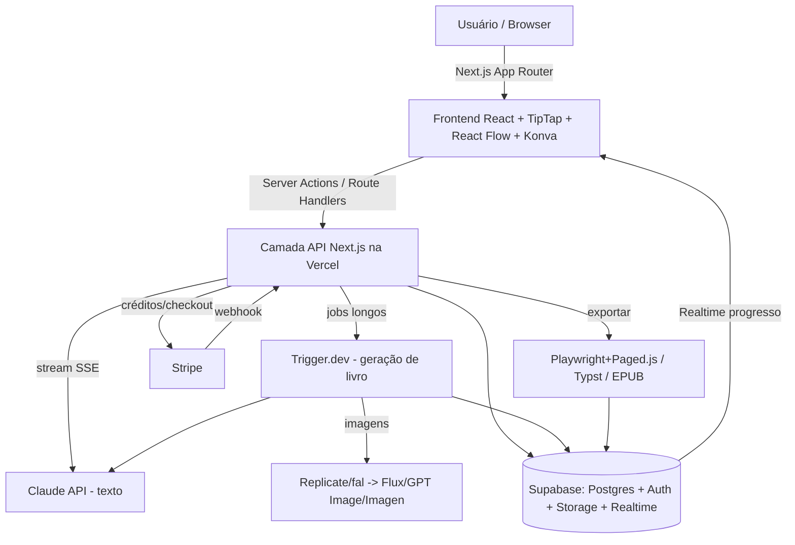

# Plano de Implementação — Gerador de Livros por IA

> Documento de especificação técnica para ser usado com **Claude Code** no VS Code.
> Stack alvo: **Claude Code + Next.js (TypeScript) + Vercel + Supabase**.
> Versão do documento: 1.0 — Maio/2026.

---

## 1. Visão geral do produto

App web onde o usuário **paga em créditos** e gera **um livro completo** (conto, romance, não-ficção/conteúdo útil de qualquer tema). A IA escreve o texto **capítulo a capítulo com efeito de digitação em tempo real**, gera **imagens** para capítulos/subcapítulos, monta **capa, contracapa, dedicatória e paginação**, oferece **edição por chat contextual**, **mapa da história (roadmap)**, **versionamento com rollback**, **editor de capa estilo designer** e **exportação final em múltiplos formatos** (PDF online + PDF pronto para impressão + EPUB).

### Princípios de arquitetura
- **Uma linguagem só de ponta a ponta:** TypeScript (front + back). Menos contexto a alternar, tipos compartilhados entre cliente/servidor/banco, e máxima compatibilidade com Vercel.
- **Geração em blocos guiada pelo usuário:** o usuário define quantas páginas gerar antes de parar para revisão. Isso, além de ser requisito do produto, encaixa naturalmente nos limites de tempo de funções serverless (cada bloco/capítulo cabe em uma requisição com streaming).
- **Tudo versionado e auditável:** cada alteração relevante vira um snapshot imutável no banco, com log estilo "deploy" e rollback.
- **Modular e reaproveitável:** a lógica de geração é separada da UI, permitindo no futuro extrair um SaaS/framework (alinhado ao seu objetivo de produtizar o método).

---

## 2. Stack tecnológica recomendada (com justificativa das linguagens)

| Camada | Escolha | Por quê |
|---|---|---|
| Linguagem principal | **TypeScript** | Tipagem forte, mesmo idioma no front e back, ecossistema gigante, ideal para Vercel. |
| Framework web | **Next.js 15 (App Router) + React 19** | Padrão de fato na Vercel; Server Actions, Route Handlers, streaming SSE nativo. |
| Estilização/UI | **Tailwind CSS + shadcn/ui + Radix** | Componentes acessíveis e rápidos de montar; visual profissional. |
| Editor de texto | **TipTap (ProseMirror)** | Editor estruturado; permite localizar trecho exato, substituir, rolar até a posição e marcar alterações — essencial para o chat de edição. |
| Mapa da história | **React Flow** | Nós clicáveis, arrastáveis, ideal para o roadmap de beats. |
| Designer de capa | **Konva.js (react-konva)** ou **Fabric.js** | Canvas com camadas, texto, fontes, cores, imagens — comportamento de editor gráfico. |
| Estado/dados no cliente | **TanStack Query + Zustand** | Cache de servidor + estado local da sessão de escrita. |
| Banco / Auth / Storage / Realtime | **Supabase (PostgreSQL)** | Auth pronta, Storage para imagens/exports, Realtime para progresso da geração, RLS para segurança, **pgvector** para a base compartilhada de palavras-chave. |
| IA de texto | **Claude API (Anthropic SDK)** | Streaming, contexto longo (até 1M tokens no Opus 4.8/Sonnet 4.6), structured outputs. |
| IA de imagem | **Aggregator (Replicate ou fal.ai)** roteando para **Flux 2 / GPT Image 2 / Imagen 4** | Um único integrador, troca de modelo por tipo de imagem, sem múltiplas contas. |
| Jobs longos / fila | **Trigger.dev v3** (ou Inngest) | Geração de livros inteiros excede limites de função; jobs com retry + progresso. |
| Pagamentos / créditos | **Stripe** (conteúdo geral) | Checkout, webhooks, controle de créditos. *(Ver §13 sobre conteúdo adulto.)* |
| Exportação PDF | **Paged.js + Chromium headless (Playwright)** | Controle fino de paginação, posição de número de página, quebras de capítulo. |
| Exportação impressão | **Typst** (alternativa de alta qualidade) | Gera PDF/print-ready programaticamente com tipografia de livro. |
| Exportação EPUB | **epub-gen-memory** | Formato padrão para leitores digitais. |

### Modelos de IA por tarefa (econômico)
- **Estrutura/roadmap, capítulos, reescritas complexas:** `claude-opus-4-8` (máxima qualidade) ou `claude-sonnet-4-6` (melhor custo/qualidade — recomendado como padrão).
- **Sugestões de palavras-chave, títulos, tarefas rápidas:** `claude-haiku-4-5-20251001` (rápido e barato).
- **Imagens:** Flux 2 Pro (fotorrealismo), GPT Image 2 (texto dentro da imagem / composição), Imagen 4 (velocidade/texto). Rotear conforme o tipo de ilustração.

> ⚠️ Use sempre **strings de modelo versionadas** (ex.: `claude-sonnet-4-6`) e confirme a lista atual em `https://docs.claude.com` antes do deploy — os nomes mudam a cada release.

---

## 3. Arquitetura geral



**Fluxo da escrita (resumo):**
1. Usuário monta a "base" do livro no construtor de prompt (tema, personagens, plot-twists — §6).
2. Define quantas páginas gerar antes de parar.
3. Job gera bloco por bloco; tokens transmitidos via streaming → efeito de digitação + auto-scroll.
4. Usuário revisa, edita pelo chat contextual, ajusta o roadmap, gera imagens.
5. Cada alteração relevante cria uma nova versão (log + rollback).
6. Monta capa no designer.
7. "Finalizar produção" → exporta em todos os formatos.

---

## 4. Modelo de dados (Supabase / PostgreSQL)

Tabelas principais (com Row Level Security ativada — cada usuário só vê o que é seu):

```sql
-- Perfil estende auth.users do Supabase
profiles            (id PK = auth.uid, display_name, birth_date, is_adult_verified bool,
                     credits_balance int default 0, created_at)

books               (id PK, owner_id FK->profiles, title, genre, language default 'pt-BR',
                     is_adult bool default false, status enum('draft','generating','review','done'),
                     page_target int, page_number_position enum('top-left','top-center',
                     'top-right','bottom-left','bottom-center','bottom-right'),
                     created_at, updated_at)

book_meta           (book_id FK, dedication text, back_cover_text text, author_name,
                     cover_design jsonb)      -- estado do canvas da capa

chapters            (id PK, book_id FK, index int, title, subtitle,
                     content_json jsonb,      -- documento TipTap/ProseMirror
                     content_text text,       -- texto puro para busca/contagem
                     status enum, tokens_used int)

chapter_images      (id PK, chapter_id FK, storage_path, prompt, model, position int)

story_beats         (id PK, book_id FK, order int, title, summary, beat_type,
                     linked_chapter_id FK nullable)   -- nós do roadmap

versions            (id PK, book_id FK, chapter_id FK nullable, label,
                     snapshot jsonb,          -- estado completo no momento
                     diff jsonb,              -- diff em relação à versão anterior
                     created_by, created_at)  -- "log de deploy"

keywords            (id PK, category enum('genre','character_role','plot_twist','tone',
                     'setting','theme'), value text, embedding vector(1536),
                     usage_count int default 1, created_by, is_global bool)
                     -- base compartilhada entre usuários (pgvector p/ sugestões semânticas)

credit_ledger       (id PK, user_id FK, delta int, reason, ref_id, created_at)
                     -- entrada (compra) e saída (geração) de créditos

generation_jobs     (id PK, book_id FK, type, status, progress int, tokens_in int,
                     tokens_out int, cost_estimate numeric, error, created_at)

exports             (id PK, book_id FK, format enum('pdf_web','pdf_print','epub'),
                     storage_path, created_at)
```

> Habilitar a extensão `vector` no Supabase para a tabela `keywords`. Índice `ivfflat` para busca por similaridade.

---

## 5. Estrutura de pastas do projeto

```
gerador-de-livros/
├── app/
│   ├── (marketing)/                # landing, preços
│   ├── (auth)/                     # login, cadastro, verificação 18+
│   ├── dashboard/                  # lista de livros do usuário
│   ├── studio/[bookId]/            # área de criação
│   │   ├── prompt/                 # construtor de base (keywords)
│   │   ├── write/                  # editor + streaming + chat de edição
│   │   ├── roadmap/                # mapa da história (React Flow)
│   │   ├── cover/                  # designer de capa (Konva)
│   │   └── versions/               # histórico + rollback
│   ├── api/
│   │   ├── generate/route.ts       # streaming de capítulo (SSE)
│   │   ├── edit/route.ts           # edição contextual via chat
│   │   ├── images/route.ts         # geração de imagem
│   │   ├── export/route.ts         # exportação final
│   │   └── stripe/webhook/route.ts
│   └── layout.tsx
├── lib/
│   ├── ai/claude.ts                # wrapper do Anthropic SDK (streaming, retries)
│   ├── ai/prompts.ts               # templates de prompt (estrutura, capítulo, edição)
│   ├── ai/images.ts                # roteador de modelos de imagem
│   ├── credits.ts                  # débito/crédito + contagem de tokens
│   ├── export/pdf.ts               # Paged.js + Playwright
│   ├── export/print.ts             # Typst
│   ├── export/epub.ts
│   ├── supabase/{client,server}.ts
│   └── versioning.ts               # snapshot + diff + rollback
├── components/                     # UI (shadcn), editor, chat, mapa, canvas
├── trigger/                        # jobs Trigger.dev (geração de livro)
├── supabase/migrations/            # SQL versionado
├── types/                          # tipos compartilhados
├── .env.local
└── package.json
```

---

## 6. Construtor de prompt (base do livro + palavras-chave compartilhadas)

**Objetivo:** o usuário monta a "engenharia" por trás do livro clicando em opções ou criando novas. Cada palavra-chave entra numa **base global compartilhada** que melhora com o uso de todos.

**Campos de entrada (exemplo Romance):**
- Tema/Gênero do livro
- Nº de personagens principais / coadjuvantes (gera fichas)
- Plot-twist desejado (Superação? Conquista? Traição e recomeço?)
- Tom, ambientação, época, público-alvo

**Mecânica das palavras-chave:**
1. Ao escolher uma categoria, o Haiku gera **N sugestões** ("quantas referências forem possíveis").
2. O usuário **clica** nas que quiser ou **digita novas**.
3. Cada nova palavra-chave é salva em `keywords` com `embedding` (pgvector). Se já existe algo semanticamente parecido, incrementa `usage_count` em vez de duplicar.
4. As sugestões futuras priorizam as mais usadas globalmente + similares semânticas → "múltiplas possibilidades de vários usuários".

**Saída:** um objeto `book_brief` (JSON) que vira o prompt-base de toda a geração.

---

## 7. Geração de texto com streaming (digitação + rolagem)

- Endpoint `api/generate/route.ts` abre um **stream SSE** com o Anthropic SDK (`stream: true`).
- O cliente lê os tokens e insere no editor TipTap progressivamente → **efeito de digitação** com `scrollIntoView` contínuo.
- A geração respeita o **page_target**: gera blocos/capítulos até atingir a meta de páginas, então **para para revisão** e muda `status` para `review`.
- Estimativa de páginas: ~250–300 palavras por página (configurável); contar palavras do `content_text` para saber quando parar.
- Cada bloco gerado grava `tokens_used` em `chapters` e debita créditos via `credit_ledger`.
- Progresso (capítulo X de Y) publicado via **Supabase Realtime**.

**Templates de prompt** (em `lib/ai/prompts.ts`): prompt de *estrutura* (gera o roadmap antes), prompt de *capítulo* (recebe brief + roadmap + capítulos anteriores resumidos), prompt de *resumo* (comprime capítulos antigos para caber no contexto).

---

## 8. Chat de edição contextual (localizar → substituir → rolar)

Requisito: usuário diz *"no trecho 'com sua barriga voltada pra cima' substitua por 'de bruços'"* → o app encontra o trecho exato, corrige e rola a tela até ele.

**Implementação:**
1. Caixa de chat na parte inferior do editor.
2. O Claude recebe a instrução + o `content_text` e retorna um **JSON estruturado**: `{ find: "...", replace: "...", chapter_id, reason }` (structured output, sem texto extra).
3. O front usa a API de busca do **TipTap/ProseMirror** para localizar o range exato de `find`.
4. Aplica a substituição, dá `scrollIntoView` no range e destaca a mudança por alguns segundos.
5. Cria uma nova **versão** automaticamente (log + rollback disponível).

> Para edições maiores ("reescreva o capítulo 3 mais sombrio"), o mesmo chat dispara uma regeneração com streaming do capítulo inteiro.

---

## 9. Geração de imagens (capa, capítulos, subcapítulos)

- Roteador em `lib/ai/images.ts`: escolhe o modelo conforme o pedido (fotorrealista → Flux 2 Pro; com texto na arte → GPT Image 2; rápido → Imagen 4), tudo via Replicate/fal.
- Prompt de imagem montado a partir do `book_brief` + resumo do capítulo (consistência de estilo/personagens).
- Imagens salvas no **Supabase Storage**; metadados em `chapter_images`.
- Custo por imagem debitado em créditos.
- **Consistência visual:** salvar um "style token" do livro (descrição de estilo) e reinjetar em todos os prompts; usar imagens de referência quando o modelo suportar.

---

## 10. Capa, contracapa, dedicatória e paginação

- **Dedicatória e contracapa:** páginas geradas automaticamente (texto editável), salvas em `book_meta`.
- **Paginação:** o usuário escolhe a **posição do número** (`page_number_position`: 6 opções). Aplicada na exportação via Paged.js (CSS `@page` + margin boxes) ou Typst.
- **Numeração inteligente:** capa/contracapa/dedicatória sem número; numeração começa no miolo (padrão de livro).

---

## 11. Roadmap / Mapa da história

- Antes (ou durante) a escrita, o Claude gera **story beats** estruturados (JSON) → tabela `story_beats`.
- Renderizados como **nós clicáveis no React Flow**, mostrando a linha lógica de evolução das ideias e a concatenação dos eventos.
- Clicar num nó abre a edição daquele ponto; salvar:
  - atualiza o beat,
  - opcionalmente **regenera** o(s) capítulo(s) vinculado(s),
  - cria nova **versão**.
- Visão "mapa" com os pontos mais impactantes destacados (clímax, viradas).

---

## 12. Versionamento, logs de "deploy" e rollback

- Toda alteração relevante chama `lib/versioning.ts` → grava um registro em `versions` com **snapshot** completo + **diff** (usar `jsondiffpatch`).
- Tela `studio/[bookId]/versions`: lista cronológica estilo **log de deploys** (rótulo, data, autor, resumo do diff).
- **Rollback:** restaurar uma versão recria o estado do capítulo/livro daquele ponto (o texto editado volta ao estágio anterior). O rollback também gera um novo registro (histórico nunca é destruído).

---

## 13. Conteúdo adulto (18+) — gating e **conformidade obrigatória**

O produto pode ofertar contos eróticos, **mas isso exige cuidados legais e técnicos sérios**. Trate como um fluxo separado e protegido:

- **Verificação de idade real**, não só checkbox. Em vários países (e crescentemente no Brasil, à luz do ECA e de regulações recentes) conteúdo adulto exige verificação robusta de idade.
- **Segregação do conteúdo:** flag `is_adult` no livro; bloquear acesso para não verificados; avisos claros e consentimento explícito.
- **⚠️ Restrições de fornecedores (ponto crítico de arquitetura):**
  - A **Política de Uso da Anthropic** restringe conteúdo sexual explícito. Usar a Claude API para gerar erótico explícito **pode violar os termos** — verifique a política vigente e, se necessário, **roteie esse fluxo específico para um provedor que permita esse conteúdo**.
  - APIs de imagem mainstream (GPT Image 2, Imagen, Flux em hosts oficiais) **filtram NSFW**.
  - **Stripe, PayPal e a maioria dos processadores mainstream restringem conteúdo adulto.** Para monetizar esse fluxo você provavelmente precisará de um **processador especializado** (ex.: CCBill, Verotel) e billing segregado.
- **LGPD:** dados de verificação de idade são sensíveis; minimize, criptografe e defina retenção.
- **Limite absoluto:** nunca permitir conteúdo sexual envolvendo menores — isso é proibido em qualquer hipótese e deve ter filtros e bloqueios ativos.

> Recomendação: lance primeiro **sem** o módulo adulto (conteúdo geral), valide o produto, e só então adicione o fluxo 18+ com a infraestrutura de compliance própria.

---

## 14. Créditos, pagamento e precificação por tokens

- Cadastro obrigatório (Supabase Auth: e-mail/OAuth).
- **Créditos** comprados via Stripe Checkout; webhook credita `credit_ledger` e atualiza `profiles.credits_balance`.
- Cada operação de IA (texto/imagem) **debita** créditos com base nos **tokens** retornados pela API (registrados em `generation_jobs`).
- **Defina o preço depois:** mantenha um fator `créditos = f(tokens_in, tokens_out, imagens)` configurável por variável de ambiente, para ajustar a margem sem mexer no código.
- Bloquear início de geração se o saldo estimado for insuficiente (estimar antes, cobrar pelo real depois).

---

## 15. Exportação final ("Finalizar produção")

Botão visível só quando `status = review/done`. Gera, em paralelo, e salva em `exports`:

| Formato | Ferramenta | Uso |
|---|---|---|
| **PDF Web** | Paged.js + Playwright | Distribuição online, leitura em tela. |
| **PDF Impressão (PDF/X, com sangria e marcas)** | Typst (ou Paged.js com perfil de impressão) | Gráfica / print-on-demand (KDP, etc.). |
| **EPUB** | epub-gen-memory | Leitores digitais (Kindle/Kobo/Apple Books). |

Inclui automaticamente capa, contracapa, dedicatória, sumário e paginação na posição escolhida. Disponibiliza links de download (Supabase Storage com URL assinada).

---

## 16. Variáveis de ambiente (`.env.local`)

```bash
# Supabase
NEXT_PUBLIC_SUPABASE_URL=
NEXT_PUBLIC_SUPABASE_ANON_KEY=
SUPABASE_SERVICE_ROLE_KEY=

# IA
ANTHROPIC_API_KEY=
ANTHROPIC_MODEL_MAIN=claude-sonnet-4-6
ANTHROPIC_MODEL_FAST=claude-haiku-4-5-20251001
REPLICATE_API_TOKEN=        # ou FAL_KEY

# Pagamentos
STRIPE_SECRET_KEY=
STRIPE_WEBHOOK_SECRET=
NEXT_PUBLIC_STRIPE_PUBLISHABLE_KEY=

# Jobs
TRIGGER_SECRET_KEY=

# Precificação (ajustável)
CREDITS_PER_1K_INPUT_TOKENS=1
CREDITS_PER_1K_OUTPUT_TOKENS=5
CREDITS_PER_IMAGE=20
```

---

## 17. Roadmap de implementação em fases (para o Claude Code)

Construa em fases pequenas e testáveis. Peça ao Claude Code uma fase por vez.

- **Fase 0 — Fundação:** Next.js 15 + TS + Tailwind + shadcn; Supabase conectado; Auth (login/cadastro); layout do dashboard. Migrations iniciais.
- **Fase 1 — Modelo de dados:** todas as tabelas da §4 + RLS + extensão `vector`.
- **Fase 2 — Créditos + Stripe:** compra de créditos, webhook, `credit_ledger`, bloqueio por saldo.
- **Fase 3 — Construtor de prompt:** UI de keywords clicáveis + criação + base compartilhada (pgvector) com sugestões via Haiku.
- **Fase 4 — Geração de capítulo com streaming:** SSE + efeito de digitação + auto-scroll + parada por `page_target` + débito de tokens.
- **Fase 5 — Editor + chat contextual:** TipTap; localizar/substituir/rolar; structured output do Claude.
- **Fase 6 — Versionamento:** snapshots, diffs, tela de log, rollback.
- **Fase 7 — Roadmap:** geração de beats + React Flow + edição por nó.
- **Fase 8 — Imagens:** roteador de modelos + Storage + consistência de estilo.
- **Fase 9 — Designer de capa:** Konva (texto, fontes, cores, imagens, camadas).
- **Fase 10 — Exportação:** PDF web, PDF impressão, EPUB; "Finalizar produção".
- **Fase 11 — Jobs longos:** mover geração pesada para Trigger.dev + progresso Realtime.
- **Fase 12 (opcional) — Módulo 18+:** somente com verificação de idade, segregação e processador de pagamento adequado (§13).

---

## 18. Prompts prontos para colar no Claude Code

**Inicialização (Fase 0):**
> "Crie um projeto Next.js 15 (App Router, TypeScript, Tailwind, shadcn/ui) chamado `gerador-de-livros`. Configure cliente e servidor do Supabase, autenticação por e-mail com tela de login e cadastro em português, e um dashboard protegido que lista os livros do usuário. Use a estrutura de pastas deste documento. Gere as migrations SQL da seção 'Modelo de dados' com RLS."

**Geração com streaming (Fase 4):**
> "Implemente `app/api/generate/route.ts` usando o Anthropic SDK com streaming SSE (modelo de `ANTHROPIC_MODEL_MAIN`). No cliente, em `studio/[bookId]/write`, insira os tokens recebidos progressivamente num editor TipTap com efeito de digitação e auto-scroll. Pare a geração quando o total de palavras atingir `page_target * 280`. Registre `tokens_used` e debite créditos conforme as variáveis de precificação."

**Chat de edição (Fase 5):**
> "Adicione um chat na base do editor. A instrução do usuário vai ao Claude junto do texto do capítulo; o Claude responde APENAS um JSON `{find, replace, chapter_id, reason}`. No front, localize o range exato com a API do ProseMirror, aplique a substituição, role até o trecho com scrollIntoView, destaque a mudança e crie uma nova versão."

*(Replique o padrão acima para as demais fases, sempre uma por vez.)*

---

## 19. Riscos e pontos de atenção

- **Tempo de função na Vercel:** geração longa precisa de Trigger.dev/Inngest (Fase 11). A geração "por blocos" mitiga isso desde cedo.
- **Custo de IA:** texto + imagens podem ficar caros; monitore tokens por livro e calibre a precificação antes de divulgar preço.
- **Direitos autorais:** oriente o usuário a não pedir cópias de obras protegidas; o conteúdo gerado deve ser original.
- **Conteúdo adulto:** ver §13 — é o maior risco legal/operacional; não improvise.
- **LGPD:** política de privacidade, consentimento, e tratamento seguro de dados (especialmente verificação de idade).
- **Consistência narrativa em livros longos:** use resumos comprimidos dos capítulos anteriores no contexto para manter coerência sem estourar tokens.

---

*Fim do documento. Use-o como `.md` de referência no VS Code e alimente o Claude Code fase a fase.*
